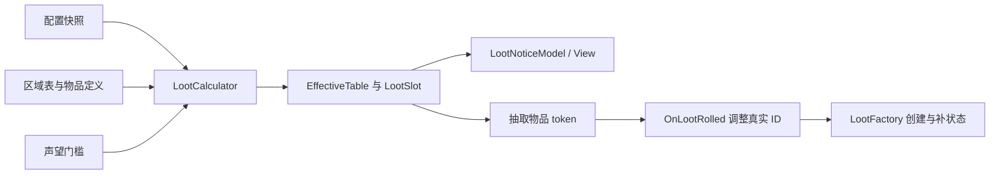

# 架构

| 目录/入口 | 职责 |
|---|---|
| src/Core.cs、ModLifecycle.cs | 加载器入口；统一启停、读档、新档顺序与界面刷新订阅 |
| src/Loot | 区域与物品定义、计算输入快照、最终概率表、奖池、物品变体与生成 |
| src/Configuration | 读取与迁移 ModConfig、滑条预览值、配置变更通知、概率缓存接入 |
| src/Progression | 声望、奖励门槛、大奖状态、存档归属与临时状态恢复 |
| src/UI | 地图选择、掉落告示板、设置控件、声望行与 tooltip |
| src/Services | 开局物资、地面尺寸/布局、付费搬运、同行夜间服务 |
| src/Compatibility | 原生掉落事件适配、可选 Reputation Pop 联动 |
| src/Patches | Harmony 接入点，调用具体服务 |
| tests、tools | 进程内规则检查、游戏扫描器检查；不打进发布包 |

## 掉落流程

`LootCalculator.Build` 接收 `LootSettings`、80 档解锁状态和夜间事件垃圾权重倍率，不读取配置、存档或 UI。`LootTableCache` 的输入比较覆盖五个设置值、解锁状态及事件倍率。UI 用 `LootNoticeModel` 将同一份最终槽位投影成分组，不再通过物品 ID 猜测它属于普通池还是贵重品池。

0.3.87 起，Tuning.TableFor 从 dumping_ground 的活动事件读取 junk_chance，先相加再换算为 Max(0, 1 + modifier/100)。LootCalculator 在基础配置与解锁门控之后乘垃圾权重，再统一归一化并计算 EV；抽样直接使用最终 Probs，不再二次乘事件倍率。ModLifecycle 订阅夜间事件开始/结束，刷新已打开的设置预览与告示板；过期事件、读档切换或倍率变化也会在下次读取时自动使缓存失效。

最终表始终保留潜在贵重品、箱子、钥匙卡槽位；未解锁或概率为零时权重为零。这样滑条变化不需要重建窗口，零概率也不会参与抽取。箱子和钥匙卡在告示板单独列出。

`LootFactory` 统一普通物品和奖品的生成、虚拟 ID、真伪、注射器状态与武器成色。只有主掉落经过 `NativeLootEvents`；奖品保持既有的奖励规则，不新增掉落事件。

## 状态与生命周期

拾荒客免扣客流由 ScavengerTrafficRules 统一判断：夜报结算查当天、次日客数查昨天的 afterhourState[dumping_ground].lastVisitDay，并核对开局、有效访问及真实外出标记。GetNormalCustomerCount 仍只在调用期间暂时隐藏 wentToAfterhoursLastNight，保持原生 Clamp 后恢复；夜报只跳过 HandleAfterhourDebuff。读档用同一判据清除原文或原生红色包装的旧误报，不改其它日志、不新增存档字段。clientStack 标有 ES3NonSerializable，读档不恢复顾客队列；20 声望奖励仍在 GenerateClient 的开门链路追加，原有读档 ResetCache 保留。

| 范围 | 状态 | 初始化/清理 |
|---|---|---|
| 全局配置 | 概率、地面、调试开关 | Tuning 与原生 ModConfig |
| 每局 | 声望、大奖窗口、命中日期与新闻日期 | 每次 Loaded 全量读取；NewGame 归零；Disable 清内存 |
| 每趟 | 选区、是否已中大奖 | 进入选择时初始化，离开时清选择，读档/禁用全量重置 |
| 每次调用 | 搜索深度、临时客流标记 | Prefix 建立；Finalizer 清理，恢复动作可重复调用 |
| 每个待保存请求 | 存档对象、runID、槽位 | DeferredSave 入队时绑定，切档/禁用时取消 |
| 每个窗口 | Unity 控件引用 | 窗口关闭/禁用时清理 |

新开局顺序由 `ModLifecycle.NewGame` 明确安排：取消旧保存 → 清理本趟 → 声望归零 → 大奖归零 → 开局初始声望 → 明确排队的调试值。模块不再分别订阅同一个新档事件来隐式决定顺序。

游戏退出菜单时 PlayerStore 可能仍存在，所以热启用只在 Emporium 已存在时同步当前档。正常读档事件则继续在游戏原有时机重读数据。

## 扩展约定

新增区域时从 Region/ScavLoot 开始，补充贵重品区域权重、箱卡映射与奖品模板，并运行规则检查。新增奖品/变体时同步 LootCatalog 估值与 LootFactory 生成路径。新增门槛与文案写在 PerkCatalog；业务用其常量，界面用其定义。

类型命名空间仍是 DumpingGroundMap；源码目录变动不改变 Harmony 类的类型名。模组 ID、开局 ID、旧存档键和配置键保留。

## 夜间同行与节点便签（0.3.83）

ScavengerOuting.Sync 将一个原生 StoreService 行放进 PlayerStore.storeService。关店面板 InitUI 前、服务费用刷新后和 OnGoingSleepEarly 都重新校正门槛与价格；不足 100 点时清掉选择，防止存档里的旧勾选绕过门槛。原版 EndNight 负责扣费；OnHandlingNightlyServicesEarly 此时位于支付循环之后，记录当天 +1 的受益日期、写晨报并取消勾选，不再自行扣款。

受益日期只存 scav_outing_day，不用静态缓存。在此日期内 GetMaxScavAttempts +2，两个受伤概率显示为零，两个实际受伤掷骰入口也跳过。没有改写原生伤势或永久免疫字段。禁用时移除本服务行，避免原生继续收费；重启用或读档时恢复行定义。

MilestoneNotes 集中维护三个阈值、收据键和便签文案；ScavengerMilestones 在开张前发放。MilestoneDelivery 负责「全部放下才记收据，失败回滚」。旧 scav_medal_given 只代表已收过信物，不代表已收到三个新节点的说明，所以升级后独立补发便签而不重复信物。

## 大奖概率模式（0.3.86）

Tuning 的 stash_window_enabled 是全局设置，默认 true，不迁移或重置存档内的 stash_chance / stash_phase。StashFind 的抽奖与告示板统一通过 JackpotChanceRules.Current 读取当前概率；关闭时直接返回当前生效上限，AfterHit / AfterMiss 不改变窗口或阶段。中奖的日期、新闻、每趟一次和后续奖励仍按原流程记入存档。

固定模式不额外抬高声望不足60时的上限；重新开启时继续原窗口，必要时按当前生效上限夹取。
